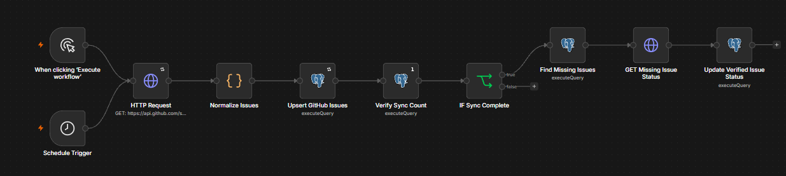
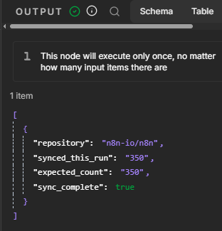
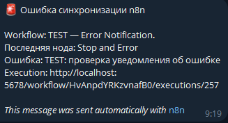

# Синхронизация GitHub Issues — n8n + PostgreSQL

Проект автоматизации на n8n для получения открытых задач из GitHub, их обработки и синхронизации с PostgreSQL. Демонстрирует работу с REST API, пагинацией, JSON, SQL, повторными запусками, контролем целостности данных и обработкой ошибок.

## О проекте

Workflow получает открытые issues из репозитория [`n8n-io/n8n`](https://github.com/n8n-io/n8n), преобразует ответы API в нормализованные записи и сохраняет их в PostgreSQL.

Для записи используется `INSERT ... ON CONFLICT DO UPDATE`: повторный запуск обновляет существующие записи, а не создаёт дубликаты.

Workflow также отслеживает задачи, которые ранее были открыты, но отсутствуют в текущей полной выборке. Вместо того чтобы автоматически считать их закрытыми, он дополнительно запрашивает их актуальный статус через GitHub API.

Синхронизация поддерживает ручной запуск и автоматический запуск по расписанию. При необработанных ошибках отдельный workflow отправляет уведомление в Telegram.

## Архитектура

Основной workflow:

```text
Manual Trigger ───────┐
                      ├──> HTTP Request (GitHub API)
Schedule Trigger ─────┘             |
                                    v
                             Normalize Issues
                                    |
                                    v
                          Upsert GitHub Issues
                                    |
                                    v
                            Verify Sync Count
                                    |
                                    v
                             IF Sync Complete
                                    |
                                    v
                            Find Missing Issues
                                    |
                                    v
                           GET Missing Issue Status
                                    |
                                    v
                        Update Verified Issue Status
```

Обработка ошибок вынесена в отдельный workflow:

```text
Error Trigger
     |
     v
Telegram — Send Message
```

Основной workflow использует этот обработчик через настройку Error Workflow в n8n.

## Реализованные возможности

- **Интеграция с REST API.** Получение задач через GitHub Search API.
- **Пагинация.** Загрузка результатов постранично с объединением данных из нескольких страниц.
- **Обработка JSON.** Преобразование API-ответа в отдельные n8n items и извлечение необходимых полей.
- **Контроль полноты данных.** Проверка структуры ответа, флага неполных результатов и соответствия количества полученных записей значению `total_count`.
- **Идемпотентная запись в БД.** Использование PostgreSQL UPSERT для обновления существующих записей без создания дубликатов.
- **Идентификатор синхронизации.** Поле `sync_run_id` позволяет определить, какие записи были обработаны в конкретном запуске.
- **Обнаружение отсутствующих задач.** Поиск ранее открытых issues, которые не попали в текущую полную выборку, с последующей проверкой их актуального статуса через GitHub API.
- **Повторные попытки.** Настройка Retry On Fail для временных ошибок HTTP Request и PostgreSQL.
- **Уведомления об ошибках.** Отправка сообщений в Telegram при необработанных ошибках workflow.
- **Автоматический запуск.** Поддержка ежедневной синхронизации через Schedule Trigger.

## Структура данных PostgreSQL

Таблица: `github_issues_sync`.

| Поле | Назначение |
|---|---|
| `repository` | Идентификатор репозитория |
| `github_id` | Уникальный идентификатор issue в GitHub |
| `issue_number` | Номер задачи в репозитории |
| `title` | Заголовок задачи |
| `state` | Текущий статус задачи |
| `author_login` | Логин автора |
| `created_at` | Дата создания |
| `updated_at` | Дата последнего обновления в GitHub |
| `closed_at` | Дата закрытия, если задача закрыта |
| `html_url` | Ссылка на задачу |
| `comments_count` | Количество комментариев |
| `locked` | Признак блокировки обсуждения |
| `labels` | Массив меток в формате JSONB |
| `body` | Текст описания задачи |
| `sync_run_id` | Идентификатор запуска n8n |
| `last_synced_at` | Время последней синхронизации записи |

Составной первичный ключ `(repository, github_id)` предотвращает создание повторных записей для одной issue в одном репозитории. Дополнительное ограничение `UNIQUE (repository, issue_number)` обеспечивает целостность номера задачи в пределах репозитория.

## Логика синхронизации

1. HTTP Request получает открытые issues по запросу `repo:n8n-io/n8n is:issue state:open -is:pr`.
2. С помощью пагинации загружаются страницы результатов GitHub API.
3. Code node объединяет результаты, проверяет полноту выборки и нормализует каждую задачу.
4. PostgreSQL UPSERT сохраняет данные и привязывает записи к текущему `sync_run_id`.
5. Проверяется соответствие количества обработанных записей количеству результатов, заявленному GitHub.
6. Только после успешной проверки выполняется поиск ранее открытых задач, отсутствующих в текущей выборке.
7. Для каждой найденной задачи запрашивается актуальный статус через GitHub API, после чего обновляется запись в PostgreSQL.

Отсутствие задачи в текущей выборке само по себе не считается достаточным основанием для изменения её статуса на `closed`.

## Тестирование

Во время разработки были проведены следующие проверки:

- Получено и нормализовано 350 issues в тестовом запуске.
- Данные успешно записаны в PostgreSQL.
- Повторно запущена синхронизация: существующие записи обновились без создания дубликатов.
- Подтверждено, что все 350 записей получили актуальный `sync_run_id`.
- Проверено общее количество записей в PostgreSQL.
- Проверено, что при полной и неизменившейся выборке запрос поиска отсутствующих задач возвращает пустой результат.
- Отдельно протестирован Error Workflow: тестовая ошибка, созданная через Stop And Error, была перехвачена, после чего уведомление успешно пришло в Telegram.

Число 350 — это количество результатов, полученное в конкретном тестовом запуске, а не фиксированное количество задач в репозитории.

## Технологический стек

- **n8n** — оркестрация автоматизации.
- **GitHub REST API** — получение данных.
- **PostgreSQL** — хранение и обновление данных.
- **SQL** — проектирование таблицы, параметризованные запросы, UPSERT и контрольные проверки.
- **JavaScript** — обработка массивов, объединение страниц и преобразование JSON в Code node.
- **Telegram** — уведомления об ошибках.
- **Docker** — среда самостоятельного размещения n8n.

## Развёртывание

1. Запустить n8n и PostgreSQL.
2. Создать таблицу `github_issues_sync` по схеме проекта.
3. Настроить PostgreSQL credentials в n8n.
4. Настроить необходимые Telegram credentials и целевой чат.
5. Импортировать основной workflow и Error Workflow из экспортированных JSON-файлов.
6. Назначить credentials в импортированных workflow и выбрать обработчик ошибок в настройках основного workflow.
7. Проверить запрос к GitHub API и соединение с PostgreSQL.
8. Выполнить ручной запуск и проверить количество синхронизированных записей.
9. Опубликовать или активировать основной workflow для автоматических запусков по расписанию.

Не следует добавлять пароли, токены доступа, API-ключи и другие секреты в репозиторий.

## Ограничения и дальнейшее развитие

- GitHub Search API ограничивает количество результатов, доступных через один поисковый запрос. Если число совпадений превысит лимит поиска, потребуется другой способ получения данных. Нельзя считать частичную выборку полной.
- Повторные попытки ограничены заданным количеством. В дальнейшем можно добавить отдельную обработку rate limit, временных ошибок сервера и постоянных ошибок запросов.
- Для промышленного использования желательно добавить журнал запусков, мониторинг ошибок и периодическую проверку согласованности данных.
- Возможные улучшения: автоматизированные тесты, настраиваемый список репозиториев, журнал синхронизаций в отдельной таблице и более подробная статистика выполнения.

## Продемонстрированные навыки

Интеграция REST API, пагинация, работа с JSON и массивами, JavaScript в n8n, PostgreSQL и SQL, моделирование данных, идемпотентность, контроль целостности данных, повторные попытки, обработка ошибок и построение интеграционных автоматизаций.

## Скриншоты

### Общая схема workflow


### Проверка синхронизации


### Уведомления об ошибках

